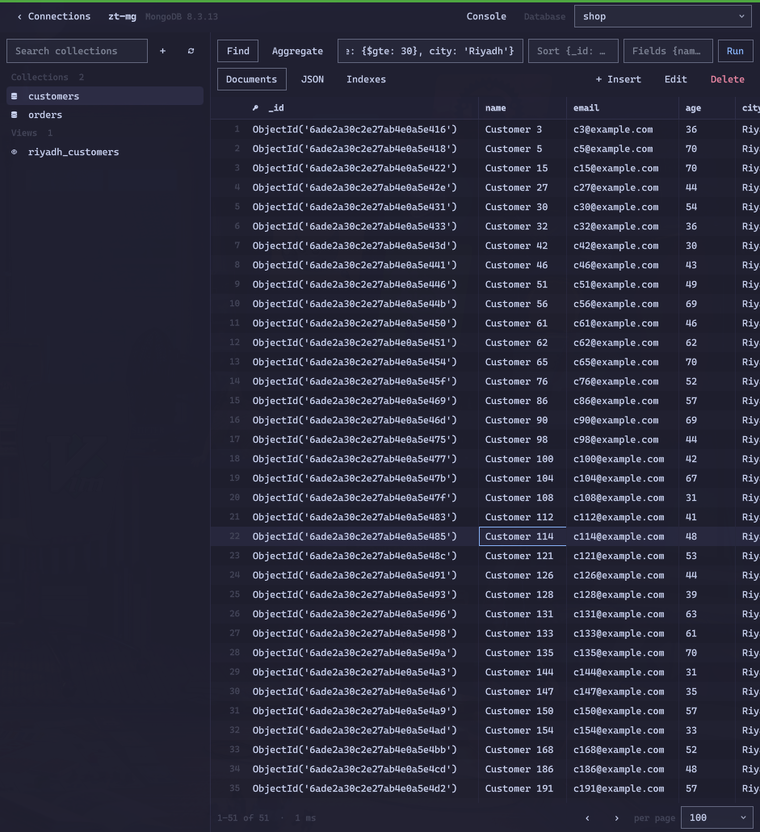

# OmaTablePlus

A TablePlus-style database GUI for [Omarchy](https://omarchy.org): connections, table browsing and editing, a
SQL editor, structure editing, export and CSV import for PostgreSQL, MySQL/MariaDB and SQLite, a key browser for
Redis/Valkey and a document browser for MongoDB.

- PostgreSQL, MySQL, MariaDB, SQLite, Redis, Valkey and MongoDB
- Servers from [OmaDBngin](https://github.com/alshareedah22/omadbngin) are listed automatically, with their credentials
- Passwords are kept in your keyring (Secret Service), never in plain files when a keyring is available
- SSH tunnels with agent, key or password login (new host keys are accepted on first use,
  `StrictHostKeyChecking=accept-new`; a changed key is refused)
- Safe mode: connections tagged **production** ask before anything that changes data

## Using it

- Double-click a connection (or select it and press **Connect**). **Test** tries the form as typed.
- **Folder** in a connection's form groups it in the list (click a folder to fold it). **Read-only** makes a
  connection browse-and-query only: OmaTablePlus refuses every change before it is sent, and the server session is
  read-only too (PostgreSQL `default_transaction_read_only`, MySQL `SET SESSION TRANSACTION READ ONLY`, SQLite
  opened read-only). The title bar shows READ-ONLY.
- Each open connection gets a tab along the top; **+** (Ctrl+Shift+N) goes back to the list to open another,
  Ctrl+PgUp/PgDown switch between them, ✕ or a middle-click closes one (asking first if it has unsaved edits).
- Pick a table in the sidebar; each table opens in a tab. Switch databases from the title bar.
- Click a column header to sort (Shift+click adds a column), **+ Filter** (Ctrl+F) to filter.
- Double-click, Enter or just start typing to edit a cell; Tab moves to the next one. Right-click for
  Set NULL, Set DEFAULT, copy and row actions. **Open in editor…** (Shift+Enter) edits long text or JSON in
  a large editor (JSON columns are formatted while you edit and saved compact).
- Ctrl+I inserts a row, Delete marks the selected row for deletion.
- Edits are staged: changed cells turn yellow, new rows green, deleted rows red. **Preview SQL** shows the
  statements, Ctrl+S commits them in one transaction, Ctrl+Shift+Delete discards them. If any statement fails
  or a row no longer matches, nothing is saved and your edits stay on screen.
- Tables without a primary key (or unique not-null key) are read-only, except in SQLite, where rows are edited
  by their rowid.

### Server

**Server ▾** in the title bar (PostgreSQL and MySQL/MariaDB):

- **Running queries…** lists the other connections and what they run, refreshing every 2 seconds (idle ones
  hidden unless you ask). **Stop** cancels a query and keeps its connection; **Kill** closes the connection.
  MongoDB has the same list under **Database ▾ → Running operations…** (with Stop).
- **Users and privileges…** lists users (PostgreSQL roles, MySQL `user@host` accounts) with their privileges.
  Create and drop users, change passwords, switch PostgreSQL role attributes (login, create databases, create
  roles, superuser), and grant or revoke privileges on the whole server, a database, a schema, all tables in a
  schema (optionally also tables created later) or one table. Every change shows its SQL first, with the
  password masked; passwords never go into the query history.

### Safe mode

Tag a connection **production** (in its form) and OmaTablePlus asks before it changes anything there: committing
edits, statements other than `SELECT`/`SHOW`/`EXPLAIN`/plain `WITH` queries, structure changes, imports,
new tables and databases, truncate and drop, killing other connections' queries, user and privilege changes, Redis commands the server marks as writes (`SET`, `DEL`, `FLUSHALL`, `CONFIG SET`, `EVAL`,
…), and MongoDB inserts, edits, deletes, index changes, `$out`/`$merge` pipelines and commands that are not
read-only. The prompt shows the exact SQL or command; Cancel leaves everything as it was. Reads never ask. The
check runs in the helper, so no button can skip it, and it leans towards asking when unsure.

Closing a tab, switching databases or leaving a connection with staged changes asks whether to discard them.
Hiding the window ends the session, so commit before you hide it.

### SQL editor

- **+ Query** (Ctrl+T) opens a query tab. Ctrl+Enter runs the statement under the cursor, or the selection;
  Ctrl+Shift+Enter runs everything.
- Each statement gets its own result tab with its row count and time. A run stops at the first error and
  keeps the results before it. Results show up to 1,000 rows each; click a header to sort them.
- **■ Cancel** (Ctrl+.) stops a running query.
- **History** (Ctrl+H) lists what you ran on this connection, searchable; click an entry to load it.
  **Save** (Ctrl+S) keeps a query under a name in the **Saved** list.
- `CREATE`/`DROP`/`ALTER` refresh the sidebar, and MySQL `USE` switches the database.
- Results of a plain `SELECT` of one table that include its primary key are editable right in the result grid
  (the status line says so): edit cells, Set NULL/DEFAULT, delete rows, then **Commit** (the SQL is shown first)
  or **Discard**. Joins, grouping, DISTINCT and computed columns stay read-only.
- **Format** (Ctrl+Shift+F) tidies the SQL, or the selection: keywords upper-case, one clause per line, lists
  and AND/OR conditions one per line, subqueries indented. Strings, quoted names and comments stay as written.
- **Explain** (Ctrl+E) shows the plan of the statement at the cursor as a tree with each step's cost and rows.
  **Analyze** runs it (only for queries that read; PostgreSQL rolls it back) and adds real rows and time; the
  slowest steps and row estimates off by 10× or more are marked red. **Raw** shows the server's own output.
- **Autocomplete** suggests as you type: tables after `FROM`/`JOIN`/`UPDATE`/`INTO`, the columns of a table or
  alias after `name.`, and otherwise the columns of the tables the statement uses, then tables and keywords.
  Up/Down pick, Tab or Enter insert, Esc closes, Ctrl+Space asks for suggestions. Names that need quotes get them.
- **File ▾** opens a `.sql` file into the editor, saves the editor to a file, or runs a whole file without
  opening it (it stops at the first error and says which statement failed). Dumps made by `pg_dump` or
  `mysqldump` belong in **Restore from file…**, which uses the server's own tools.

### Structure, export and import

- **Back up database…** (**Server ▾** in the title bar) writes the current database to a file: plain SQL from
  `pg_dump` or `mysqldump`/`mariadb-dump` (with routines and triggers), or a copy of a SQLite file.
  **Restore from file…** runs a backup against the current database (`psql` in one transaction, so a failure
  changes nothing; `pg_restore` for custom-format dumps; `mysql`/`mariadb`). The tools come from PATH or from
  OmaDBngin's engines, matching the server's major version when it can. Passwords reach them through the
  environment or a private option file, never the command line. A Cancel button stops a running job.
- **Views, functions and triggers**: right-click a view or function for **Edit definition** (its SQL opens in
  a query tab to change and run, as `CREATE OR REPLACE` where the engine has it) or **Drop**; the **+** above
  the table list and a schema's right-click menu have **New view…** and **New function…** templates; a table's
  right-click menu has **New trigger…**, and its Structure page a **Triggers** tab (edit, drop, add).
- **Table diagram** (**Server ▾**) draws the tables as boxes, key columns marked, with a line from each foreign
  key column to the column it references. Drag a box by its title, Ctrl+wheel or −/+ to zoom, **Fit**,
  **Arrange** to lay them out again; click a title to open the table.
- **New table…** (the **+** above the table list, or right-click a schema) takes a name and a list of columns:
  type (type it or pick a common one), NULL rule, default (as SQL) and which columns form the primary key. The
  `CREATE TABLE` statement is shown as you type; the new table opens in Structure.
- **Databases…** (**Server ▾**, PostgreSQL and MySQL/MariaDB) lists the server's databases: create one, open
  one, or drop one after a confirmation. PostgreSQL cannot drop the database you are connected to, so open
  another one first. A SQLite database is one file: add a connection for a new file instead.
- **Structure** (the switch under a table, or right-click → Structure) lists columns, indexes, foreign keys and
  the table's DDL. Rename columns, change type, NULL rule, default (as SQL, e.g. `0`, `'none'`, `now()`) or
  comment, add and drop columns and indexes, add foreign keys (columns → table and its columns, with
  `ON DELETE`/`ON UPDATE`) and drop them. Changes are staged; Ctrl+S shows the SQL and
  applies it after you confirm.
  - PostgreSQL and SQLite apply all of it in one transaction. MySQL commits each statement on its own, so a
    failure there says how many statements already ran.
  - SQLite can only rename, add and drop columns; changing a type means recreating the table.
- **Export** (under a table, on a query result, or right-click → Export…) writes CSV, JSON or SQL `INSERT`s. A
  table export respects the current filters and sort; a result export runs that statement again and saves all
  its rows. Files are written atomically, readable only by you, and never over an existing file unless you
  say Replace.
- **Import CSV…** (right-click a table) reads the file, guesses the delimiter, maps CSV columns to table columns
  by name (change any mapping or skip a column) and inserts every row in one transaction: one bad row and
  nothing is imported, with the line numbers in the error.
- Right-click a table for **Truncate…** and **Drop…**; both ask first. Right-click a cell to copy the row as
  TSV, JSON or an `INSERT`.

### Redis and Valkey

- Keys are listed with SCAN: type a pattern (`user:*`) and press Enter, or pick a type. **Load more** keeps
  scanning big databases. Each key shows its type and time to live.
- The value pane fits the type: a text editor for strings (**Format JSON**, Ctrl+S saves), tables for hashes,
  lists, sets, sorted sets and streams. Double-click an item (or hover it for ✎ and ✕) to change or remove it,
  **+ Field / Push / Member / Entry** to add one. Collections show their first 1,000 items.
- List edits check the item is still the one you saw, so a concurrent change is refused instead of
  overwriting the wrong position.
- **Rename**, **Set TTL…** (or remove the expiry) and **Delete** act on the key; deleting asks first.
  **+ Key** (Ctrl+N) creates one of any type.
- Binary keys and values are shown with `\xHH` escapes and are written back byte for byte.
- **Console** (Ctrl+`) runs any command with redis-cli style replies and Up/Down history. Commands that
  would block the connection (SUBSCRIBE, MONITOR, BLPOP, …) are refused; `SELECT n` switches the browser.

### MongoDB

- Collections and views are on the left (right-click to drop, **+** for a new collection).
- **Database ▾** creates a database (with its first collection, since MongoDB only keeps databases that hold
  something), drops the current one, backs it up to a `.tar.gz` in mongodump's layout (collections, documents,
  indexes and views; `mongorestore` reads it once extracted) and restores such a file into the current database.
- **Find** takes a filter, sort and field list in mongosh syntax: `{age: {$gt: 30}, city: 'Riyadh'}`,
  `{_id: ObjectId('…')}`, `{joined: {$gte: ISODate('2025-01-01')}}`, `/regex/i`. Plain JSON and Extended JSON
  work too. Click a column header to sort on the server. Pages hold 50 to 1,000 documents.
- **Aggregate** runs a pipeline (Ctrl+Enter); results are read-only.
- **Documents** shows top-level fields as columns; **JSON** shows whole documents. Double-click or **Edit**
  opens a document in the JSON editor (Ctrl+S saves the whole document; the `_id` cannot change).
  **+ Insert** (Ctrl+I) takes one document or a list; right-click a row to duplicate it or copy it.
- **Indexes** lists, creates (`{email: 1}`, unique or not) and drops indexes.
- **Console** runs database commands such as `{dbStats: 1}` or `{count: 'orders'}`.
- Views are read-only. Finds and aggregations stop after 60 seconds.
- Users sign in against the `admin` database (where OmaDBngin and most installs create them); `mongodb+srv://`
  URLs are not supported yet.

| Shortcut | Action |
|---|---|
| Ctrl+S | Commit staged changes |
| Ctrl+Shift+Delete | Discard staged changes |
| Ctrl+I | Insert row |
| Ctrl+F | Add a filter |
| Ctrl+R / F5 | Reload |
| Ctrl+C | Copy cell |
| Ctrl+W, Ctrl+Tab | Close / cycle tabs |
| Ctrl+T | New query tab |
| Ctrl+Shift+N | Back to the connection list |
| Ctrl+PgUp / Ctrl+PgDown | Previous / next connection |
| Ctrl+Shift+Tab | Cycle tabs backwards |
| Ctrl+Enter | Run statement at cursor (or selection) |
| Ctrl+Shift+Enter | Run all statements |
| Ctrl+. | Cancel the running query |
| Ctrl+E | Explain the statement at the cursor |
| Ctrl+Shift+F | Format the SQL |
| Ctrl+Space | Ask for autocomplete suggestions |
| Ctrl+S (query tab) | Save the query |
| Ctrl+H | History and saved queries |
| Ctrl+` | Redis / MongoDB console |
| Ctrl+N | New Redis key |

## Install

Install OmaTablePlus from the Omarchy plugin manager. Then add the **OmaTablePlus** bar widget, or open the window with:

    omarchy-shell shell summon blackcode.omatableplus '{}'

The bar widget toggles the window. Summoning with `'{"connect": "<connection id>"}'` opens that saved connection
(OmaDBngin's **Open in OmaTablePlus** sends `omadb:<name>`).

The first launch installs the database drivers into `~/.local/share/omatableplus/venv`. Every wheel is pinned by
version and SHA-256 in `requirements.lock`; anything that does not match is refused.

OmaTablePlus was called OmaTable before 1.6. On its first launch it moves `~/.config/omatable` to
`~/.config/omatableplus`, moves each saved keyring password the first time it is used, and removes the old driver
venv in `~/.local/share/omatable`, but only when that venv's own stamp file shows OmaTable created it.

## Update

Update from the Omarchy plugin manager. The drivers are reinstalled on the next launch only when
`requirements.lock` or the system Python's minor version changed. Your connections and history stay as they are.

## Requirements

Omarchy with Python 3 including `venv` and `ensurepip` (for the helper and its venv; on Arch they are part of
`python`, and without them the first launch fails with "could not create … venv" or "No module named ensurepip"), `wl-copy` for copying, `ssh` for tunnels, and a Secret
Service keyring (GNOME Keyring or KeePassXC) to keep passwords out of plain files. The drivers (psycopg, PyMySQL,
redis-py, pymongo) come from PyPI on first launch, pinned by hash. [OmaDBngin](https://github.com/alshareedah22/omadbngin)
is optional. Backups use `pg_dump`/`psql` or `mysqldump`/`mysql` (or the MariaDB versions), from PATH or
OmaDBngin's engines. Running the editor tests needs `node`.

## Remove

    omarchy plugin remove blackcode.omatableplus
    rm -rf ~/.config/omatableplus ~/.local/share/omatableplus
    secret-tool clear app omatableplus

The first command removes the plugin. The other two are optional: they delete your saved connections, query
history, the drivers and the saved passwords in your keyring ("OmaTablePlus … password" items). OmaTablePlus never
changes your databases' files or OmaDBngin's servers.

## Files

- `~/.config/omatableplus/connections.json`: saved connections (mode 600)
- `~/.config/omatableplus/history.jsonl`, `queries.json`: query history (last 1,000 runs) and saved queries
  (mode 600, since SQL can contain secrets)
- `~/.local/share/omatableplus/venv`: the drivers

## Development

    /usr/bin/python3 -m unittest discover -s tests -t . -v                     # unit tests
    OMATABLEPLUS_TEST_NET=1 /usr/bin/python3 -m unittest discover -s tests -t . -v # plus driver install
    tools/update-requirements-lock                                              # bump drivers

Database tests need the OmaDBngin servers `zt-pg` (PostgreSQL 17), `zt-my` (MariaDB), `zt-vk` (Valkey 9),
`zt-rd` (Redis 8) and `zt-mg` (MongoDB 8, user `dev`), and the drivers' venv:

    OMATABLEPLUS_TEST_DB=1 ~/.local/share/omatableplus/venv/bin/python -m unittest discover -s tests -t . -v

SSH tests start a private, unprivileged `sshd` on a free port when `/usr/bin/sshd` exists.

## License

MIT
